# DPPM: Dual-Path Parametric Memory for Personalized Language Models — Figures and Tables

Original paper: Yuhao Chen et al. (2026). DPPM: Dual-Path Parametric Memory for Personalized Language Models. arXiv:2610.11776v1.  
Source: https://arxiv.org/pdf/2610.11776v1  
PDF version: arXiv:2610.11776v1 (12 pages; 8 Oct 2026)  
Output: **PNG only**, rendered at **611 DPI** from original PDF vector/text content.

Crop rectangles and PDF page numbers are recorded in the [manifest](../../manifests/dppm-2026.json). The original source must match the manifest version.

## Figures (5)

| Figure | Original PDF page | Preview | Obsidian / Markdown |
|---|---:|---|---|
| Figure 1 | 1 | 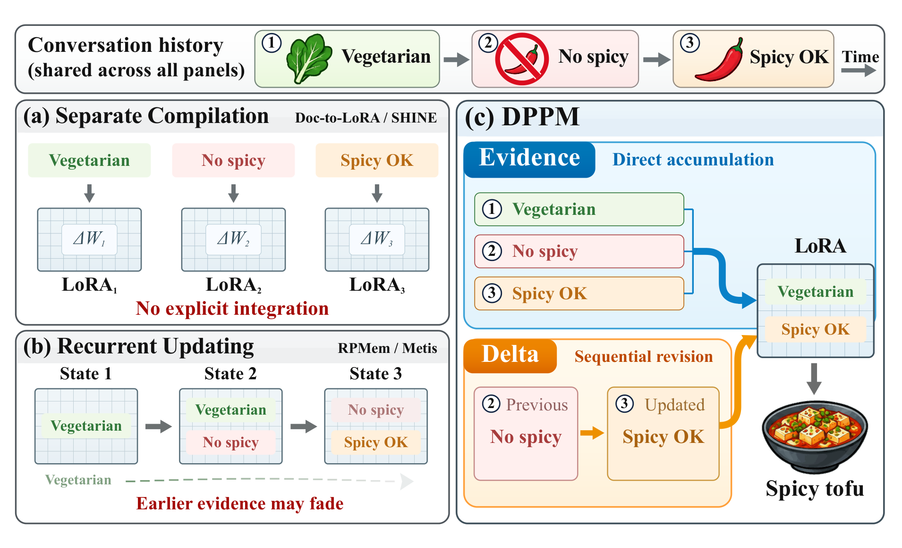 | `` |
| Figure 2 | 3 | 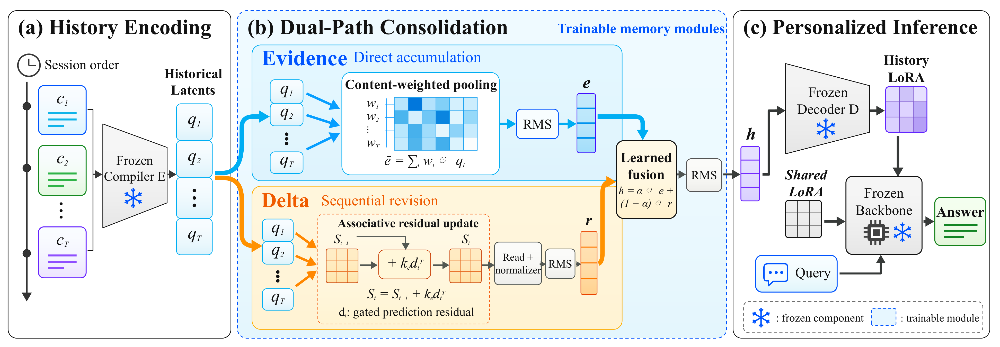 | `` |
| Figure 3 | 7 | 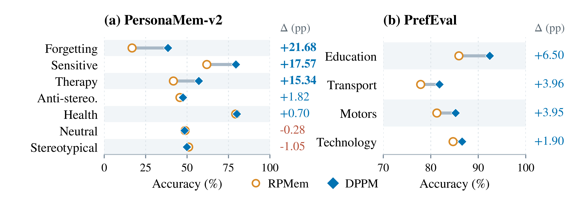 | `` |
| Figure 4 | 7 | 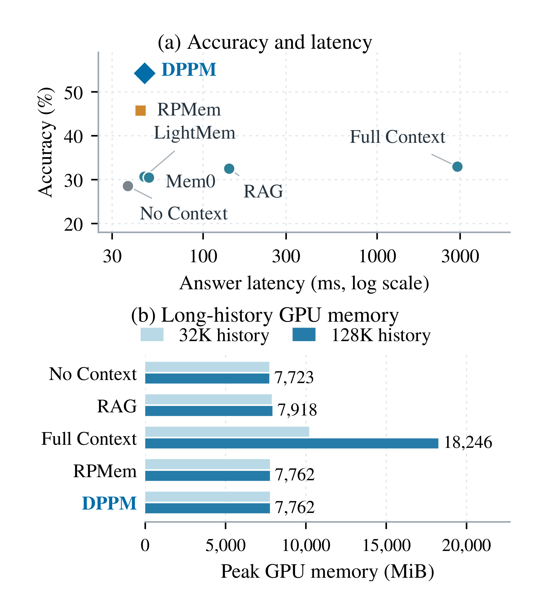 | `` |
| Figure 5 | 8 | 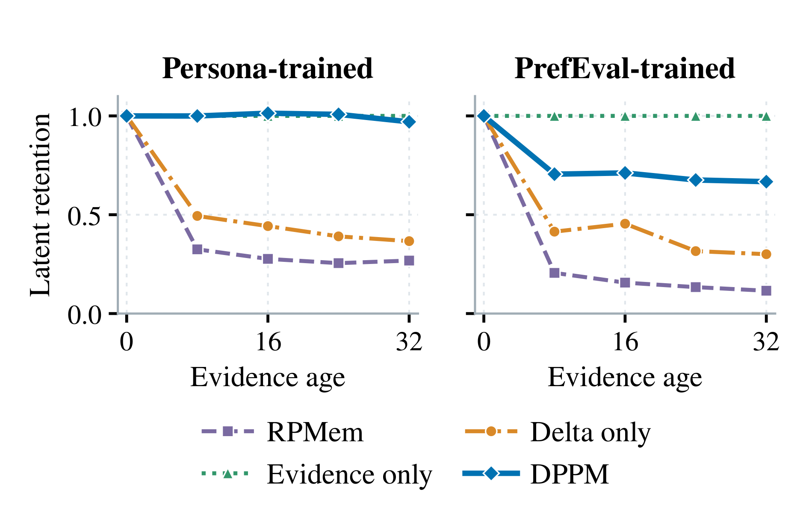 | `` |

## Tables (6)

| Table | Original PDF page | Preview | Obsidian / Markdown |
|---|---:|---|---|
| Table 1 | 5 | 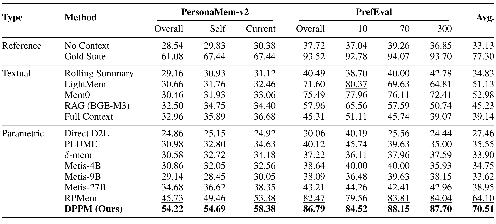 | `` |
| Table 2 | 6 | 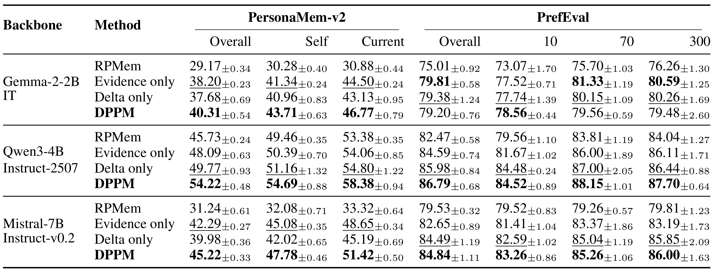 | `` |
| Table 3 | 6 | 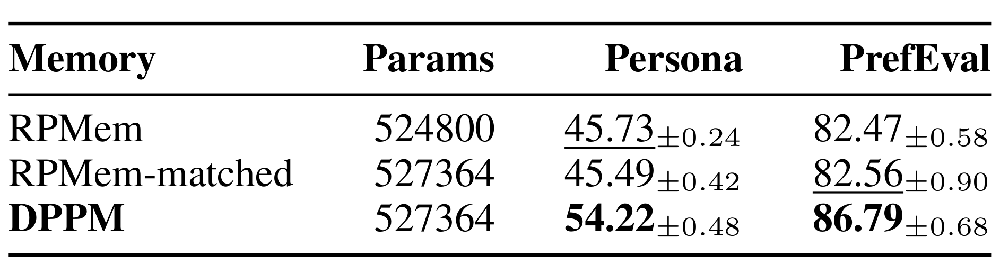 | `` |
| Table 4 | 8 | 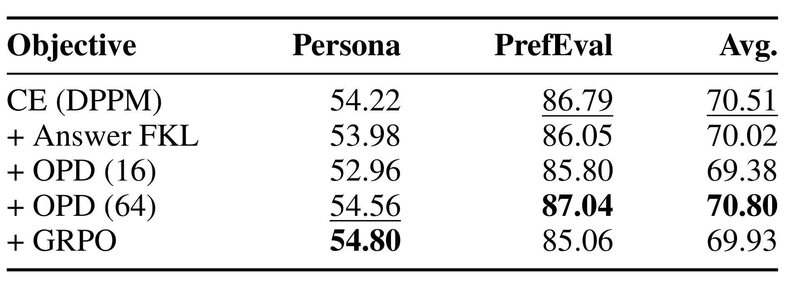 | `` |
| Table 5 | 10 | 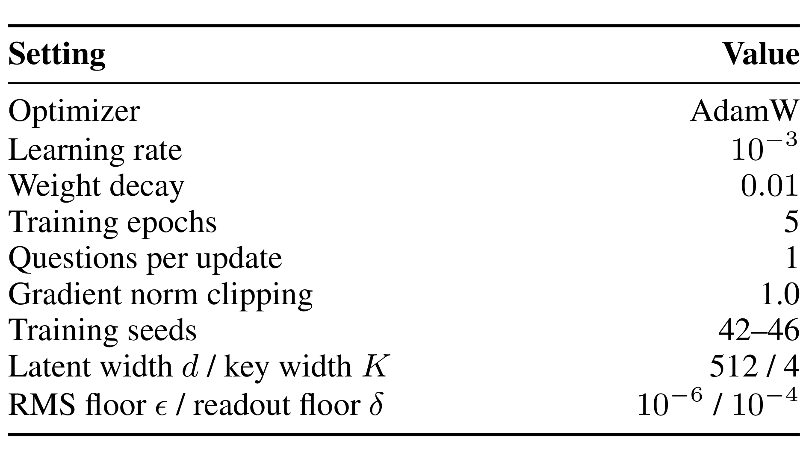 | `` |
| Table 6 | 11 | 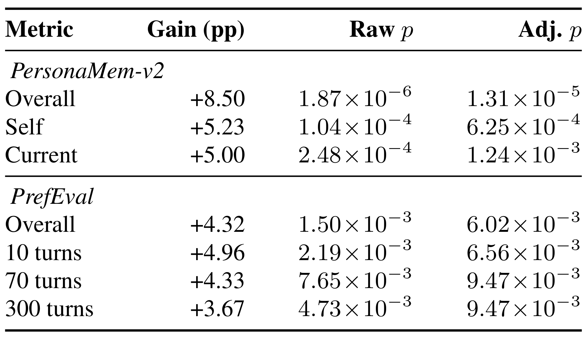 | `` |

## Reuse & attribution

These are unaltered crops of the original authors' figures and tables (not redrawn).
Credit the original paper and comply with its applicable license when reusing assets.
See [the repository-wide workflow](../../docs/PAPER_ASSET_WORKFLOW.md) for conventions.
