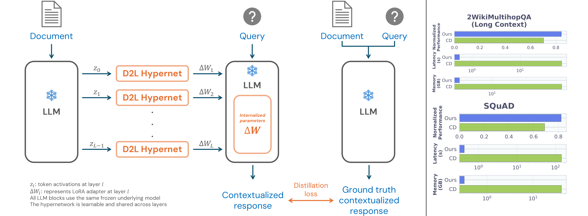
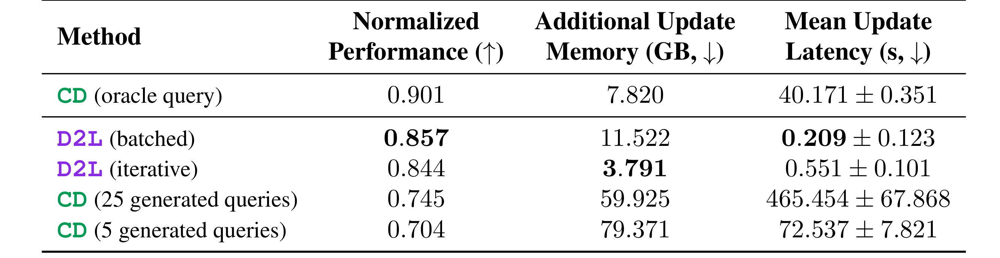

# Paper-figures — 学术论文图表素材库

本仓库用于保存**直接从原始论文 PDF 精确裁剪的高清 PNG**，供论文翻译、Obsidian、Markdown 和学术汇报引用。支持正文与附录的全部 **Figure 和 Table**。**不再导出裁剪版 PDF。**

## 入口

- **[通用图表处理规范](docs/PAPER_ASSET_WORKFLOW.md)**：识别、核对、裁剪、渲染、命名、上传、引用及质量验收的完整工作流程。**任何 AI 处理新论文前，都应先读取此文档。**
- **[论文翻译图表处理 Prompt](prompts/PAPER_TRANSLATION_ASSETS.md)**：一段供 AI 翻译论文时使用的简短指令；技术细节以仓库通用规范为准。
- [通用提取脚本](scripts/extract_paper_assets.py) · [论文清单配置](manifests/) · [GitHub Actions 自动化](.github/workflows/build-paper-assets.yml)

## 已收录论文

| 论文 | 图 | 表 | 来源 | 索引 |
| --- | ---: | ---: | --- | --- |
| RPMem: Learning Long-Term Recurrent Parametric Memory Across Sessions for LLM Agents (Zhao et al., 2026) | 7 | 32 | [arXiv:2609.23466v2](https://arxiv.org/abs/2609.23466v2) | [RPMem](Papers/RPMem/README.md) |
| DPPM: Dual-Path Parametric Memory for Personalized Language Models (Chen et al., 2026) | 5 | 6 | [arXiv:2610.11776v1](https://arxiv.org/abs/2610.11776) | [DPPM](Papers/DPPM/README.md) |
| Doc-to-LoRA: Learning to Instantly Internalize Contexts (Charakorn et al., 2026) | 13 | 12 | [arXiv:2602.15902v1](https://arxiv.org/abs/2602.15902) | [Doc-to-LoRA](Papers/Doc-to-LoRA/README.md) |

## 统一目录布局

```text
Paper-figures/
├── README.md
├── docs/PAPER_ASSET_WORKFLOW.md
├── prompts/PAPER_TRANSLATION_ASSETS.md
├── scripts/extract_paper_assets.py
├── manifests/<paper-slug>.json
├── .github/workflows/build-paper-assets.yml
└── Papers/
    ├── DPPM/
    ├── Doc-to-LoRA/
    └── <Paper-Name>/
        ├── README.md
        ├── figures/Figure_01.png, Figure_02.png, ...
        └── tables/Table_01.png, Table_02.png, ...
```

图片采用 PDF 原始图形直接高倍率渲染，**默认约 611 DPI，即原有 288 DPI 版本的约 4.5 倍总像素量**（每边约 2.121 倍），不对已有位图插值放大。具体分辨率和裁剪坐标记录于各论文 `manifests/*.json`。

**新增论文必须存放在 `Papers/<Paper-Name>/`。** Manifest 中 `output_dir` 填写完整仓库相对路径（如 `Papers/Example-Paper`），提取脚本会拒绝仓库根目录的论文输出。根目录只存放公共文件；不维护旧图片链接兼容。

DPPM 已收录 5 图 6 表，Doc-to-LoRA 已收录 13 图 12 表；整理目录不修改 PNG 内容。

### Markdown / Obsidian 引用

```markdown



```

请保留论文作者与来源信息，复用图片时遵守原文适用的版权或许可证。